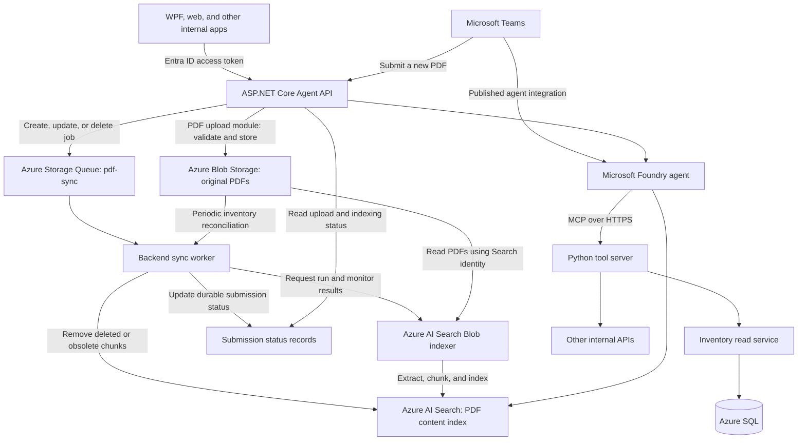

# KnowledgeBridge

KnowledgeBridge is a planned internal knowledge and inventory assistant. Microsoft Teams and custom clients share one Microsoft Foundry agent, one company PDF knowledge source, and the same Python tools. Organization users submit new PDFs through the KnowledgeBridge Teams app. Azure Blob Storage holds the original PDFs, and Azure AI Search indexes their content for the agent.

**Repository status:** architecture and delivery plan, Terraform for a Foundry account/project in a manually created resource group, and a [runnable Python MCP example with two tools](src/knowledgebridge_tools/README.md). The manually created resource group is `knowledge-bridge` in subscription `2f482561-182f-4bd5-840b-1dc7d21f0811` in Canada Central. Foundry account/project configuration and an MCP agent setup command are prepared; they have not been applied. The API, sync worker, live agent deployment, Teams publishing, and document ingestion pipeline are not implemented yet. Earlier Terraform foundation source files are absent from the current workspace; see [current infrastructure scope](infra/README.md).

## Architecture

The Teams arrow represents a supported published agent/channel integration, including its authentication and conversation handling. It is not a direct unauthenticated call from Teams to a private Foundry endpoint. Both routes must resolve to the same deployed agent version and tool contracts.

### Request flow

1. A WPF, web, or other internal client signs in with Microsoft Entra ID and obtains an access token for the Agent API.
2. The ASP.NET Core API validates issuer, tenant, audience, scopes or roles, and conversation ownership, then invokes the shared Foundry agent using its workload identity.
3. Teams users access the same agent through the configured Teams publishing integration. Channel identity is mapped to the same application authorization rules.
4. For document questions, the agent retrieves authorized PDF chunks from Azure AI Search and returns citations. PDFs must first be ingested, extracted, chunked, indexed, and kept current.
5. For live business data, the agent calls allowlisted tools on the Python MCP server. The server authorizes the request and calls the inventory read service or another internal API.
6. Only the inventory service queries Azure SQL. It returns bounded, structured results; the agent never executes arbitrary SQL.

### Teams PDF submission and indexing

1. Any organization user with access to the installed KnowledgeBridge Teams app can submit a PDF from personal chat, group chat, or an enabled team/channel. Roll out the app to the intended organization audience; file access still follows the user's permissions.
2. The PDF submission module inside the ASP.NET Core Agent API authenticates the Teams request and sender, then retrieves the explicitly submitted attachment using the appropriate Teams/Microsoft Graph file flow. Teams files initially reside in OneDrive or SharePoint; the API copies the submitted PDF into private Azure Blob Storage. It does not automatically import every Teams file. Cross-scope file handling must use supported Graph permissions and tenant consent. See [Teams file handling](https://learn.microsoft.com/en-us/microsoftteams/platform/bots/how-to/bots-filesv4).
3. Validate the file type and size, perform the configured malware checks, and assign a stable document ID. Preserve submitter, source team/channel, original file reference, version/hash, and document access permissions. Store accepted originals in the private `company-pdfs` container, with permission metadata suitable for indexing.
4. After the Blob upload and permission metadata are committed, the API adds a job to the durable `pdf-sync` Storage Queue and returns an accepted response with a submission ID. The backend sync worker consumes the job, validates the referenced document/version, requests a run of the configured Search Blob indexer, and monitors processing. The indexer reads `company-pdfs` with the Search identity and performs configured extraction, chunking, and optional OCR/embeddings. Search keeps a derived content index; Blob Storage remains the original PDF repository.
5. The worker updates durable submission states: received, queued, processing, indexed, or failed. The API exposes these states and delivers Teams notifications. Confirm that the submitted document/version has actually been indexed before marking it indexed. Retry transient failures without creating duplicate documents.
6. Queries use permission-filtered Search results with source/page citations. Route downloads through an authorized endpoint or the original authorized Teams file; never expose the private blob URL as a public link. Handle replacements, deletion detection, and removal of all derived chunks explicitly.

The Search-to-Storage path needs both `Storage Blob Data Reader` and approved private outbound connectivity. A client-facing Search private endpoint alone does not provide this path. See [managed identity storage access](https://learn.microsoft.com/en-us/azure/search/search-howto-managed-identities-storage) and [Search shared private links](https://learn.microsoft.com/en-us/azure/search/search-indexer-howto-access-private).

### PDF submission inside the Agent API

PDF submission is a module of `src/KnowledgeBridge.AgentApi/`, sharing the API deployment and `agent-api` managed identity. It does not require a separate project, runtime host, or submission identity.

| Planned API module | Responsibility |
| --- | --- |
| Teams attachment handler | Validate the channel request and sender, authorize submission, retrieve the selected file through Teams/Graph, and acknowledge receipt. Keep channel authentication separate from custom-client JWT validation. |
| Document lifecycle module | Validate uploads, deduplicate by source/version, preserve trusted ACL metadata, store originals in `company-pdfs`, and enqueue create/update jobs. Authorize deletions, persist a delete tombstone, and enqueue removal work without losing the document-to-chunk mapping. |
| Submission and sync status endpoints | Return received, queued, processing, indexed, deletion-pending, deleted, or failed status only to authorized callers. Use durable records; report deletion complete only after indexed content is removed. |
| Indexing coordination | Hand off to the separately hosted sync worker through `pdf-sync`; expose the worker's persisted results through the API and Teams notifications. |

The API handles intake and status; PDF indexing runs asynchronously outside the request. Configure an authenticated Teams ingress path to the API alongside its private Storage access. The upload module is planned here; application code has not yet been created.

### Backend sync worker

`src/KnowledgeBridge.SyncWorker/` is a separately hosted .NET Worker Service with the existing `ingestion` managed identity. It synchronizes additions, updates, and deletions between the Blob PDF repository and Azure AI Search. It coordinates indexing and removes stale search content. The existing identity name is retained; the worker does not host the Teams upload endpoint.

- **Durable handoff:** queue messages contain operation (`create`, `update`, or `delete`), submission ID, stable document ID, monotonic lifecycle revision, blob path, blob ETag/version where applicable, correlation ID, and attempt information. Store PDF bytes only in Blob Storage. Treat queued references as untrusted and restrict them to the configured container.
- **Upload recovery:** a Blob upload and queue send are separate operations. Persist the ready-to-index submission record before enqueueing; run reconciliation to re-enqueue ready submissions that lack an active/completed job. Do not report a queued state unless publishing succeeds. The durable status store/schema remains application work.
- **Processing:** acquire a job with a visibility timeout, verify the ready document/version and metadata, and mark it processing. Coalesce bursts of uploads into indexer runs and coordinate across worker replicas. A run processes detected Blob changes; it is not a single-file indexing call.
- **Concurrency and completion:** an indexer cannot run concurrently with itself. If it is busy, retain pending work and request a subsequent run when needed. Monitor run results and verify indexed document/version markers; an accepted run or overall run success alone does not prove every submitted PDF was indexed. See [indexer execution](https://learn.microsoft.com/en-us/azure/search/search-howto-run-reset-indexers).
- **Retry and failure:** renew visibility during long work, apply bounded retries/backoff, and deduplicate by document/version. Persist completion before deleting a queue message. On retry exhaustion, write failure details to `pdf-sync-poison`, persist failed status, and notify the submitter through the API. Make poison handling restart-safe and provide an operator replay path.
- **Deletion sync:** authorize deletion in the API and persist a durable tombstone before any physical removal. Mark the blob with custom deletion metadata, configure the Search data source's matching deletion policy from its first run, and retain the blob until removal is confirmed. Run the indexer and explicitly verify/remove every indexed chunk for that document using its stored keys or filterable parent document ID. Only then finalize Blob removal and mark the lifecycle record deleted. Search document deletes use document keys, not a delete-by-filter API.
- **Direct Blob deletion:** periodically reconcile a complete, successful Blob inventory against the durable document/chunk manifest. Missing active originals generate delete work, even if the API was bypassed. Never infer deletion from a failed listing or transient access error. Preserve tombstones and chunk mappings independently of Blob lifetime so hard-deleted files can still be removed from Search.
- **Original Teams file deletion:** keep the source OneDrive/SharePoint drive-item reference captured at upload. Plan a permitted Graph change-tracking/reconciliation path so confirmed source deletions create the same delete jobs for the copied Blob and Search content. Treat lost permissions or temporary source errors as sync failures requiring investigation, not proof of deletion. This source connector and its permissions remain to be implemented.
- **Ordering and recovery:** serialize lifecycle operations per document or reject stale revisions; a late create/update job must not resurrect a deleted document. Coordinate indexer runs and deletion cleanup, then recheck for stale chunks. Retain scheduled incremental indexing and full lifecycle reconciliation as recovery for missed jobs and interrupted workers. A restored file uses a new lifecycle revision and an explicit update job.

Blob versioning is enabled in Terraform. Use the custom metadata deletion policy above and explicit worker cleanup; Azure AI Search's native Blob soft-delete detection does not support version-enabled storage. Do not assume removing a blob automatically removes its Search documents. See [Blob change/deletion detection](https://learn.microsoft.com/en-us/azure/search/search-how-to-index-azure-blob-changed-deleted) and [document deletion](https://learn.microsoft.com/en-us/azure/search/search-how-to-delete-documents).

Worker hosting, job processing, the durable status store, indexer definitions, and notifications are planned application work. Queues, private queue access, and identity permissions must be added to the current resource-group-only Terraform configuration; it does not implement or run the worker.

## Projects and component work plans

These paths are the proposed application layout. `infra/` currently contains resource-group configuration, and `src/knowledgebridge_tools/` contains a runnable local two-tool MCP example. Other application projects remain planned.

| Component / proposed project | Responsibility | Work plan | Completion criteria |
| --- | --- | --- | --- |
| WPF, web, and internal clients — `clients/` | Sign-in and chat experience | Integrate MSAL; request API scopes; add streaming responses, citations, history, cancellation, and accessible error states. Keep agent credentials on the server. | A signed-in user can chat and open citations; expired tokens and forbidden conversations are handled correctly. |
| Microsoft Entra ID — identity configuration | Authenticate people and workloads | Register API and client applications; define delegated scopes and application roles; configure tenant restrictions, consent, and workload identities; document group-to-permission mapping. | Invalid tenant/audience tokens are rejected and each service has only its required permissions. |
| ASP.NET Core Agent API — `src/KnowledgeBridge.AgentApi/` | Custom-client chat plus Teams PDF submission and status | Configure JWT validation for clients and channel authentication for Teams; implement conversation ownership, streaming, Foundry invocation, and rate limits. Add an internal PDF submission module to retrieve authorized Teams files, validate/deduplicate PDFs, preserve ACL metadata, write `company-pdfs`, and expose durable indexing status. Use the API identity for Blob writes. | Authorized chat reaches the shared agent; Teams PDFs are stored once with correct permissions; status matches indexing results; invalid files and unauthorized conversation/document access fail safely. |
| Microsoft Teams — `channels/teams/` | Shared-agent chat and new PDF submissions | Configure the published agent and a PDF submission handler; enable personal, group, and team/channel scopes as supported; configure Graph access and tenant consent; roll out to organization users; return upload/indexing status. Validate channel access to the private backend. | Users can chat and submit PDFs from each supported scope; inaccessible files are rejected; indexing status is visible. |
| Microsoft Foundry agent — `agents/knowledgebridge/` | Shared orchestration and answer generation | Choose an available model deployment; version instructions; configure Search and MCP connections; set tool allowlists, approval policy, grounding, refusal behavior, and conversation retention; build a representative evaluation set. | Both channels use the same version; answers cite documents; live questions invoke tools; unsupported requests fail safely. |
| Azure Blob Storage — `company-pdfs` | Store original PDFs submitted through Teams | Provision a private container; permit the Agent API identity to write and Search identity to read; keep source/ACL/version metadata, retention, and private authenticated downloads. | Submitted PDFs persist privately and can be read by the indexer; originals remain independent of the Search index. |
| Backend sync worker — `src/KnowledgeBridge.SyncWorker/` | Keep Search synchronized with PDF additions, updates, and deletions | Consume `pdf-sync` lifecycle jobs; coordinate indexer runs; persist document/chunk mappings and tombstones; remove all deleted/obsolete chunks; reconcile missing blobs; enforce operation ordering; implement retries, visibility renewal, poison jobs, and replay. | New/replaced PDFs are searchable; deleted originals leave no searchable chunks; duplicate/out-of-order jobs and worker restarts cannot resurrect deleted content; failed sync is visible and replayable. |
| PDF sync queues — Azure Storage Queue | Buffer document lifecycle jobs independently of API and worker availability | Provision private `pdf-sync` and `pdf-sync-poison` queues; grant API send and worker processing/poison-send roles; define create/update/delete schema, lifecycle revisions, retry limits, and replay ownership. | Jobs survive API/worker restarts; only authorized identities can send or process them; exhausted jobs can be investigated and replayed. |
| Azure AI Search — definitions in `search/` | Index PDFs from Azure Storage and retrieve authorized content | Define the managed-identity Blob data source, indexer, schedule, index, and any skillset; approve the private Storage link; define text/vector fields, ACL filters, citations, and ranking. Validate permission filtering with the Foundry integration. | A Teams-submitted PDF in Blob Storage becomes searchable with correct citations and permissions; unauthorized content is excluded. |
| Python tool server — `src/knowledgebridge_tools/` | Expose business operations through MCP | Implement a remote MCP endpoint with typed schemas; expose read-only inventory tools and selected API adapters; validate tokens, caller roles, and trusted user context; enforce timeouts, pagination, result limits, and redacted audit logs. | Foundry can discover and call tools over the selected network path; invalid requests and unauthorized access are rejected. |
| Inventory read service — `src/KnowledgeBridge.Inventory/` | Domain boundary for inventory reads | Define inventory DTOs and endpoints; implement parameterized queries, stock/warehouse filters, pagination, authorization, and managed identity SQL access; separate database and transport concerns. | Approved inventory queries return accurate bounded results; callers cannot submit SQL or perform writes. |
| Other internal APIs — adapters in the Python tool project | Connect existing business systems | Inventory endpoints and owners; document schemas and authentication; implement one adapter per system; define retry rules, rate limits, timeouts, and permission checks. Treat existing APIs as dependencies rather than resources to recreate. | Each adapter has contract coverage, an owner, and predictable handling of outages and access denial. |
| Azure SQL — schema/migrations in `database/` | Store inventory data | Define or map the existing schema; add required indexes and migrations; configure Entra-only authentication, private access, backups, and a restricted database user for the inventory identity. | Inventory identity can select approved tables/views and cannot modify data; query performance and restore procedures are verified. |
| Terraform infrastructure — `infra/` | Repeatable Azure foundation | Provision network, private endpoints/DNS, Foundry account/project, Search, PDF storage, SQL, and workload identities; then add runtime hosting, private agent egress, monitoring, and environment-specific state. | Formatting and validation pass; an authenticated plan is reviewed; deployment and private connectivity are verified in the target subscription. |

## Authorization and data boundaries

- Client access tokens target the Agent API. Downstream services obtain their own tokens; do not forward an API token to an unrelated audience.
- Workload identity authenticates a service, not the end user. Choose delegated/on-behalf-of access where supported or carry verified user context through a trusted server-side authorization design. A user ID supplied in a prompt or tool argument is not authorization.
- Enforce document ACLs and inventory permissions in retrieval and service code. Instructions alone cannot enforce access control.
- Keep inventory tools read-only initially. Treat retrieved PDFs and tool responses as untrusted content; prevent them from changing tool permissions or instructions.
- Track requests across channels, API, agent, MCP tools, and inventory without logging tokens, sensitive PDFs, or unrestricted tool results.

## Delivery sequence

| Phase | Deliverables | Exit criteria / dependencies |
| --- | --- | --- |
| 1. Contracts and identity | API/tool contracts, representative PDFs, inventory schema, permission model, model/region decision | Data owners approve access rules and sample questions; channel/network compatibility is understood. |
| 2. Infrastructure foundation | Review and deploy `infra/`; configure remote state and private runner access | Private DNS resolves; public data access is blocked; identities and SQL administrator are configured. |
| 3. First vertical slice | Inventory service, one Python MCP tool, private agent networking/runtime, model deployment, agent, minimal API/client | An authorized user gets a live inventory answer through the shared agent; unauthorized access fails. |
| 4. Document grounding | API PDF upload, Blob originals, durable queues, backend worker, status store, Blob data source/indexer, Search connection, ACL trimming, citations | A Teams upload queues work and becomes searchable asynchronously; worker restarts, duplicate jobs, busy indexers, poison jobs, update/delete handling, and document access checks pass. |
| 5. Channel rollout | Full custom client UX and Teams pilot | Both routes use the same agent configuration and pass the same authorization scenarios. |
| 6. Operational readiness | Telemetry, alerts, load/evaluation tests, deployment pipelines, backup/restore exercise | Owners approve quality, latency, cost, retention, recovery, and support runbooks. |

## Infrastructure project

See [infra/README.md](infra/README.md) for the created resource group, Terraform import instructions, and current infrastructure scope. The Terraform project reads the manually created `knowledge-bridge` resource group and defines a Foundry account/project inside it; the group remains externally managed. The agent setup command reuses the existing two MCP tools when supplied with a reachable HTTPS MCP URL and a model deployment. Search, Storage, SQL, queues, private networking, MCP hosting, and Teams integration remain planned. The two-tool Python MCP example runs locally with demonstration data.

Assumptions: a new single-region environment; read-only inventory access; internal clients; existing internal APIs remain external dependencies. The example region and development SKUs must be checked against service availability, quota, data residency, budget, and reliability requirements before deployment. For an existing inventory database, adapt the SQL resources to data sources/imports before applying; do not provision a replacement unintentionally.

## References

- [Foundry private networking](https://learn.microsoft.com/en-us/azure/foundry/agents/how-to/virtual-networks)
- [Foundry MCP authentication](https://learn.microsoft.com/en-us/azure/foundry/agents/how-to/mcp-authentication)
- [Foundry networking options](https://learn.microsoft.com/en-us/azure/foundry/agents/concepts/networking-options)
- [AzureRM Foundry account resource](https://registry.terraform.io/providers/hashicorp/azurerm/latest/docs/resources/cognitive_account)
- [AzureRM Foundry project resource](https://registry.terraform.io/providers/hashicorp/azurerm/latest/docs/resources/cognitive_account_project)
